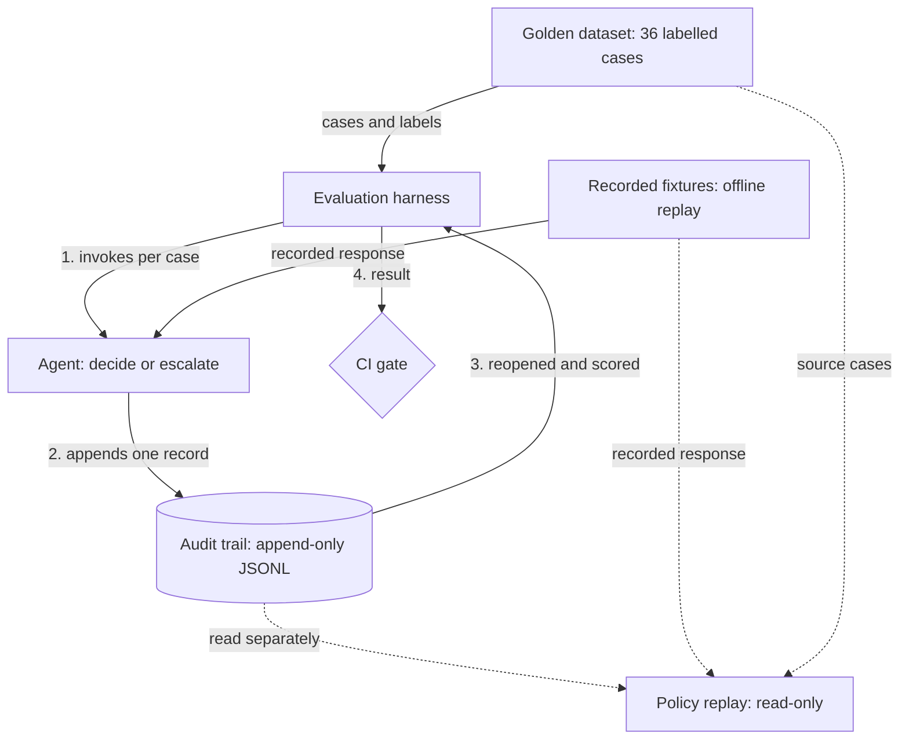

# AgentTrail

[](https://github.com/SusanaCodes/agenttrail/actions/workflows/ci-gate.yml?query=branch%3Amain)

AgentTrail demonstrates a reusable engineering pattern for AI-agent
decisions: **record what happened, evaluate the recorded behaviour,
and gate changes against explicit expectations.**

This offline reference implementation writes decisions to an audit
trail, then scores the stored records against labelled examples. It
detects tested routing regressions for the selected fixture snapshot.
The bundled fictional routing task makes that control pattern runnable.

The image shows the gate rejecting three intentionally seeded missed
escalations: 9 of 12 protected cases escalate, below the required 12.


*Captured CLI output rendered as an image, 8 October 2026.* The
[raw capture](docs/assets/ci-gate-v2-failure.txt) is verbatim stdout;
the command, exit-code line and red highlighting were added to the image.
"Gate blocked" means a failed gate; merge and deployment boundaries
are in [Limitations](#limitations). The badge follows pushes to `main`,
excluding manual seeded-`v2` runs.

## Ten-minute quickstart

Prerequisites: Git and Python 3 (CI pins Python 3.12). Nothing else is
needed: no third-party packages, no virtual environment, no AWS
credentials, and no network access after the clone. Run every command
from the repository root.

```bash
git clone https://github.com/SusanaCodes/agenttrail.git
cd agenttrail
```

Run the baseline v1 gate. Expected: `CI GATE: PASS`,
`measured_rate=1.0000`, `low_confidence_escalated=12`, exit `0`.

```bash
python3 -m agenttrail.ci_gate --agent-version v1
echo $?
```

Run the intentionally regressed v2 gate. Expected: `CI GATE: FAIL`,
`measured_rate=0.7500`, `low_confidence_escalated=9`, exit `1`.

```bash
python3 -m agenttrail.ci_gate --agent-version v2
echo $?
```

`v2` returning exit code `1` is the expected seeded failure.
Exit `2` from either command indicates a genuine execution error (a
missing, invalid or undecodable fixture, dataset or audit input).

### Optional verification

The full test suite runs in seconds and needs no setup. Expected:
`Ran 442 tests`, output ending `OK`, exit `0`.

```bash
python3 -m unittest discover -s tests
```

Policy replay needs a stored trail, so write one to a temporary path
first. Expected from the second command: `records evaluated: 36`,
`unchanged: 35`, `flipped: 1`, the line
`SYN-031: decide -> escalate`, exit `0`.

```bash
TRAIL="$(mktemp -d)/replay.audit.jsonl"
python3 -m agenttrail.eval --audit-path "$TRAIL"
python3 -m agenttrail.policy_replay --audit-path "$TRAIL" \
  --target-policy v2 --legacy-baseline-policy v1
```

Current audit records do not store `policy_version`. The
`--legacy-baseline-policy v1` option explicitly declares the baseline
as an operator-supplied assumption, not recorded policy provenance.

## What AgentTrail does

- Routes a structured case automatically or escalates it to a human.
- Appends each decision to a structured audit trail.
- Evaluates the records actually stored, rather than the model's return value.
- Fails a deterministic CI gate when audited routing disagrees with a
  golden label or the low-confidence escalation rate misses its minimum.
- Separately replays stored decisions under a proposed routing policy
  to report which outcomes would change.

Model responses come from committed fixtures matched by request
fingerprint, so evaluation and gating need no credentials or live
model calls. Recording new fixtures is a separate, paid Bedrock path.

## The worked example and adaptation

The bundled **fictional benefit-style cases** use only `age_band`,
`income_band` and `evidence_status`; missing evidence must escalate.
The cases, rules and labels are invented test data, with no real
applicant data or operational benefit policy.

The routing task is deliberately simple and rule-derivable: it
demonstrates the control pattern, rather than the business value of
using an LLM or a multi-step autonomous agent.

The reusable pipeline is **decision → stored audit record → behavioural
evaluation → version-controlled gate**. Adapting it to workflows such
as support triage or operational change review requires code and tests
for their schemas, prompts, decision logic, client contracts, labels and
scoring rules. See the [adaptation guide](docs/adapting-agenttrail.md).

## Headline demonstration

Both agent versions use the same 36-case golden dataset and gate policy:
minimum low-confidence escalation rate `1.0000`, tolerance `0.0000`.

| Version | Behaviour on the 12 protected cases | Escalation rate | Gate |
|---|---|---|---|
| `v1` (recorded baseline) | All 12 escalate | `1.0000` | PASS, exit `0` |
| `v2` (synthetic, seeded regression) | 9 escalate; 3 auto-decide | `0.7500` | FAIL, exit `1` |

The `v1` responses are described by the maintainer as recorded from
Bedrock; their origin is not independently authenticated. The `v2`
fixtures are constructed responses paired with an over-confident
prompt to demonstrate the failure path. Neither verdict measures
current live model behaviour.

On failure, the gate names the breached escalation-rate property,
reports the shortfall and exits non-zero. A manual `v2` Actions run
turns red and skips the downstream no-op `deployment-demo` job;
[the recorded run](https://github.com/SusanaCodes/agenttrail/actions/runs/38130274254)
shows that path.

### Verified figures

Each figure is a separate measurement. The gate, dataset and
policy-replay figures were last reproduced on 8 October 2026 at commit
`a558713`, with network access denied and no AWS credentials, using the
commands in the [quickstart](#ten-minute-quickstart). The unit-test
count is the current suite, re-run on 10 October 2026 after regression
tests for error-message hygiene, the redaction gate and malformed input
encodings were added; it was 345 on 8 October and 430 on 9 October.

| Figure | Result |
|---|---|
| Unit tests | 442 run, all passing, exit `0` |
| Golden cases | 36 labelled synthetic cases |
| Protected cases in the main gate | 12: the cases labelled low-confidence, which must all escalate |
| Agent `v1` | 12 of 12 protected cases escalate. Gate PASS, exit `0` |
| Agent `v2` (synthetic, seeded) | 9 of 12 protected cases escalate and 3 are auto-decided. Gate FAIL, exit `1` |
| Policy replay under routing policy `v2` | 36 stored records replayed: 35 unchanged, 1 flip (`SYN-031`, decide to escalate), exit `0` |

Two different things are called `v2`, and they are unrelated:

- **Agent version `v2`** is the seeded regression above: an
  over-confident prompt with synthetic fixtures. It is what makes the
  gate fail.
- **Routing policy `v2`** is a proposed confidence threshold of `0.95`
  in place of `0.70`. Policy replay re-routes the stored `v1` records
  under it and reports which decisions would change. It is read-only
  change-impact evidence; it approves and rejects nothing, and it is
  not part of the gate.

## Architecture



The harness invokes the agent once per golden case, discards what the
agent returns, then reopens the trail and scores only what was written
there. The CI gate runs the harness and applies a fixed policy to its
result. Policy replay is a separate command that reads an existing
trail and writes nothing. The agent is never shown the expected labels.
The [project manual](docs/project-manual.md#4-architecture) has the
full diagram.

## Limitations

This is a prototype and reference implementation, with no
production-readiness, legal-compliance or government-endorsement claim.
The [security assessment](docs/security-assessment.md) records verified
controls, open findings and the evidence for them; its
[verification record](docs/security-assessment.md#verification-record)
and the [open-code assessment](docs/open-code-assessment.md) retain the
full control history.

The low-confidence override is protected by unit tests. The
fixture-backed behavioural evaluation does not exercise it, because no
recorded response falls in the sub-threshold `decide` region.

The request hash proves the replay request matches the stored request
byte for byte. It does not bind the response to that request and does
not prove that Bedrock produced the response. Fixture re-recording is a
reviewed act that the gate cannot itself authenticate.

Details: [CI gate coverage gap](docs/ci-gate.md#known-coverage-gap-the-low-confidence-override)
and [fixture provenance](docs/model-fixtures.md#what-the-request-hash-does-and-does-not-establish).
The other material boundaries are:

- **Offline scope.** Results cover a recorded snapshot and seeded
  fixtures, not current live behaviour, general model quality, fairness
  or bias. The verdict depends on the committed fixtures and labels.
- **Storage and replay.** The local append-only JSONL trail is neither
  tamper-evident nor durable production storage. Record lookup displays
  a stored record; it does not reproduce a decision. Policy replay is
  read-only change-impact evidence and neither approves nor rejects a
  proposed policy; its legacy baseline is an operator declaration.
- **Merge and deployment controls.** The `main-protection` ruleset
  requires `evaluation-gate`, `dependency-audit` and `secret-scan`, an
  up-to-date pull request, and no bypass; force-push and deletion are
  blocked. A missing-check PR was blocked
  ([PR #16](https://github.com/SusanaCodes/agenttrail/pull/16), attribution
  by elimination against the effective rules). A required check cannot
  prove its own workflow logic has not been weakened. `CODEOWNERS`
  records file ownership; independent code-owner approval is deferred
  in this sole-maintainer repository. The deployment job is a no-op;
  no real deployment workflow exists.
- **Privacy scope.** The redaction gate checks three supported formats:
  National Insurance numbers, UK postcodes and NHS numbers. A passing
  scan does not establish that all personal data is absent.
- **Implementation scope.** There is no RAG, vector database,
  multi-agent orchestration, dashboard or runtime monitoring. Optional
  live fixture recording needs `boto3` from the hash-locked
  `requirements-recording.txt`, AWS credentials and Bedrock access;
  it makes paid calls and is outside the quickstart.

## Documentation

- [Project manual](docs/project-manual.md): end-to-end walkthrough,
  architecture, Article 12 mapping and documentation index.
- [Decision log](docs/decision-log.md): engineering choices and trade-offs.
- [Security assessment](docs/security-assessment.md): findings, risks
  and verification evidence; an assessment, not a sign-off.
- [Demo scenario](docs/demo-scenario.md): full baseline and seeded-failure output.

Future gateway and tooling work is **planned, not built**; see the
[Phase 2 roadmap](docs/project-manual.md#13-future-improvements-phase-2).

## Maintenance, security and licence

Susana ([@SusanaCodes](https://github.com/SusanaCodes)) maintains the
prototype on a best-efforts basis; only the head of `main` is maintained.

- [Maintenance and ownership](docs/maintenance.md): support scope,
  review dates, dependency review, handover and retirement.
- [Security policy](SECURITY.md): private reporting and response targets.
  Reporting, secret scanning and push protection were enabled and read
  back on 11 October 2026; the reporting and push-block paths remain
  unexercised. See the
  [control evidence](docs/open-code-assessment.md#evidence-update-11-october-2026).
- Optional recording, deck and maintenance dependencies install from
  hash-locked `requirements-*.txt` files; Dependabot proposes weekly
  updates, merged only after security and gate checks pass.
- [MIT licence](LICENSE). The
  [September safety review](docs/pre-publication-safety-review.md) is
  historical evidence and does not cover later changes.

**Provenance:** a solo training-programme project built on personal
resources and accounts, partly in allocated working hours; publication
followed the maintainer's 10 October 2026 decision, documented in the
[full provenance record](docs/open-code-assessment.md#licence-and-provenance).
